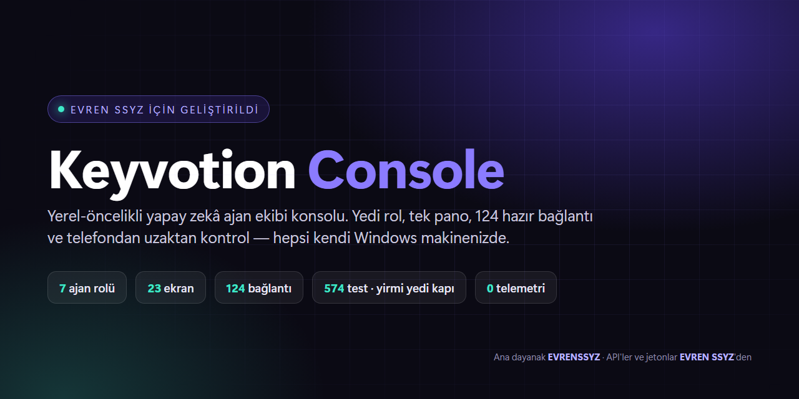
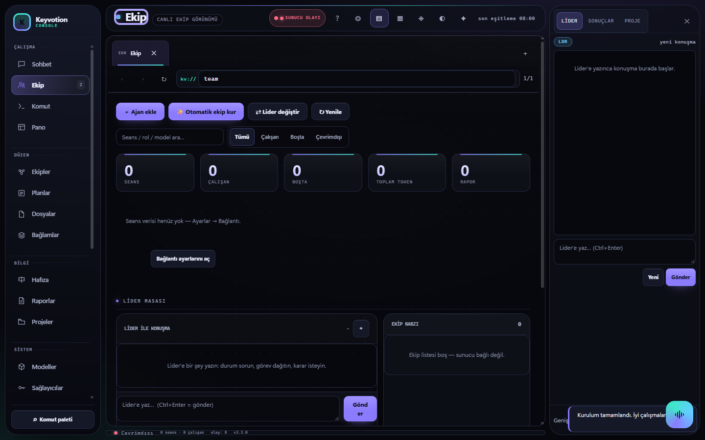
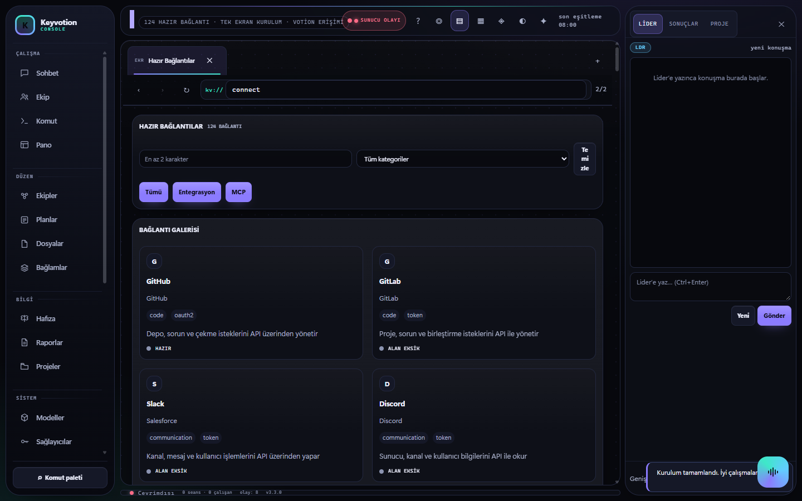
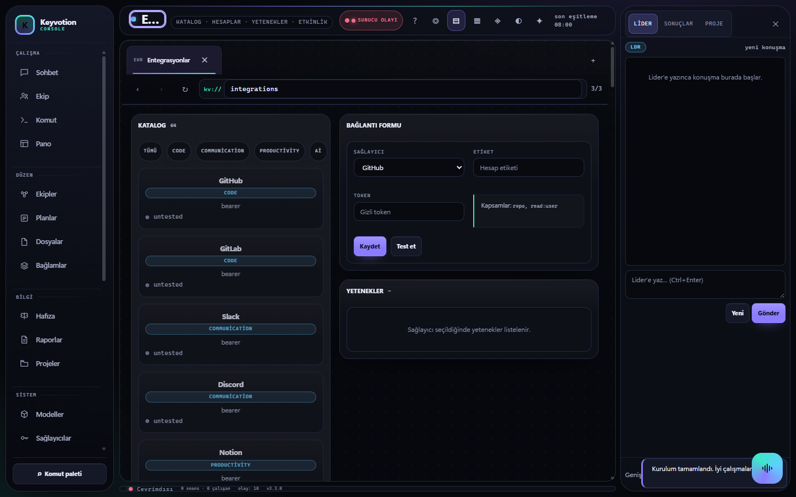
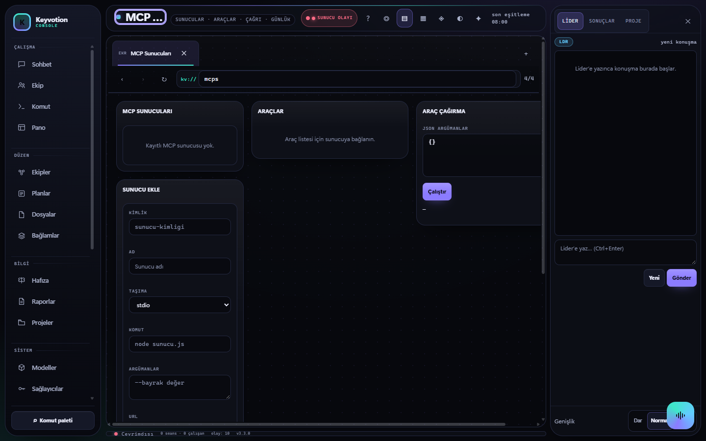
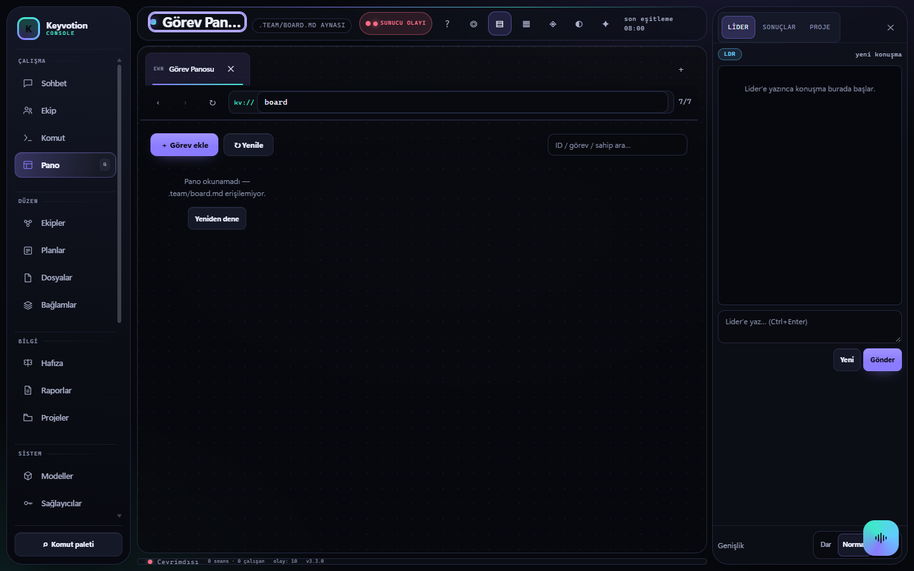
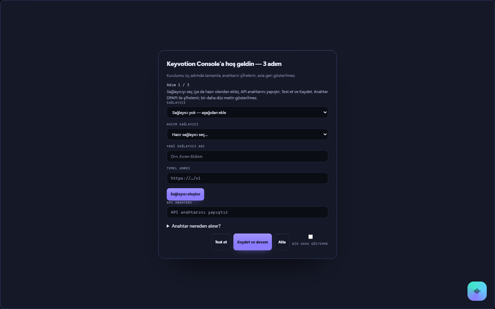

# Keyvotion Console

**EVREN SSYZ için geliştirilmiş, yerel-öncelikli yapay zekâ ajan ekibi konsolu.**
Yedi rol, tek pano, 124 hazır bağlantı ve telefondan uzaktan kontrol — hepsi kendi
Windows makinenizde; bulut arka ucu yok, telemetri yok.

[](LICENSE)
[](#gereksinimler)
[](#quality-gates)
[](#mimari)

---

## Bu proje neden var?

**Keyvotion Console, EVREN SSYZ için yapılmış bir projedir.** Amacı tek bir şey:
bir yapay zekâ modelini tek başına konuşturmak yerine, onu **bir ekibin parçası**
gibi çalıştırmak. Lider hedefi verir, mimar planı böler, yazılımcı üretir, test
yazılımcısı kapıyı işletir. Hepsi aynı panoda, aynı hafızada ve aynı kurallarla.

Bu konsolun **ana dayanağı EVRENSSYZ**'dir. Uygulamanın kullandığı **API'ler ve
API jetonları EVREN SSYZ adresinden alınır**; kullanıcı kendi anahtarını oradan
alır ve uygulamaya bağlar. Yani Keyvotion Console, EVREN SSYZ üzerinde çalışan
modelleri tek bir masaüstü konsolunda, güvenli ve ölçülebilir biçimde yönetmek
için tasarlandı. Model, sağlayıcı ve jeton sizin elinizde kalır; konsol yalnızca
işi düzenler.

Neden bu kadar önemli?

- **Tek pencere, gerçek ekip.** Yedi rol (LDR, YM, ARC, DEV, DSN, QA, OPS) aynı
  panoda çalışır; kim ne yapıyor, ne bekliyor, ne bitti — hepsi görünür.
- **Sizin makineniz, sizin veriniz.** Pano, raporlar, ayarlar ve katalog proje
  klasörünüzde durur. Sırlar Windows kasasıyla (DPAPI) şifrelenir.
- **Ölçülebilir kalite.** 574 otomatik test ve yirmi yedi kalite kapısı depoyla
  birlikte gelir; "çalışıyor" demek için ölçüm gerekir.
- **Telefondan kontrol.** Aynı Wi-Fi ağındaki telefonunuzdan ekibi izler,
  mesaj gönderir, panoyu görürsünüz.

## Ekran görüntüleri

| Ekip | Bağlantılar |
| --- | --- |
|  |  |

| Entegrasyonlar | MCP sunucuları |
| --- | --- |
|  |  |

| Görev panosu |
| --- |
|  |

İlk açılış, hazır sağlayıcılarla üç adımlı bir sihirbazdır; Ollama gibi yerel bir
sunucu için API anahtarı bile gerekmez:



## Neler var?

| Alan | Ne alırsınız |
| --- | --- |
| **Ajan ekibi** | Yedi rol (LDR, YM, ARC, DEV, DSN, QA, OPS), pano, mesajlar, raporlar, planlar, hafıza |
| **Ayarlar** | Bağlantı, sunucu, telefon, görünüm, sistem, kadro, beceriler, izinler, Votion yetkileri ve **tanılama** — tek ekranda, aranabilir |
| **Tanılama** | Tek tuşla altı ölçüm: köprü, yerel sunucu, parola kasası, telefon erişimi, proje dizini, denetim kaydı; kopyalanabilir rapor |
| **Telefon kartı** | Uzaktan erişimi aç/kapat, kodu yenile, eşleşme adresini kopyala — ayrı ekrana gitmeden |
| **Modeller** | Sağlayıcı anahtarları (şifreli), canlı model kataloğu, görev başına model seçimi, yedekleme |
| **Bağlantılar** | 64 entegrasyon / 195 yetenek + 60 MCP sunucusu = 124 şablon |
| **Entegrasyon kimliği** | OAuth2 (kopyalanacak anahtar yok), API anahtarı/jetonu, MCP kurulumu — her birinde **Test** düğmesi |
| **Asistan** | Votion: sesli yanıt + izin listeli araç manifestosu; her yazma onay jetonu ister |
| **Sohbet kurtarma** | Başarısız yanıt, **Yeniden dene** ve **Kopyala** sunan bir hata kartına dönüşür |
| **Taslak otomatik kaydı** | Yarım yazılmış mesaj ekran değişimlerinde, yeniden başlatmada ve yenilemede yaşar |
| **Ekran okuyucu yönlendirmesi** | Ekran değişince odak başlığa gider ve ekran adı duyurulur |
| **Dürüst kısayol sayfası** | `?` sayfası dokuz ekran kısayolunu, tuş işleyicisiyle aynı tablodan üretir |
| **Sesli sohbet durumu** | Yanıt durumu kibar bir canlı bölge; başarısız gönderim kesin bir dille duyurulur |
| **Açılış bütçesi** | Paketlenmiş exe 25 ms'de bir yoklanır; ılık açılış ortanca 800 ms, soğuk üst sınır 3000 ms |
| **En yeni mesaja dön** | Eski mesajları okurken "en alta in" düğmesi belirir; tek tıkla sona döner |
| **Sohbet okuma konumu** | Yeniden çizim, en altta değilseniz kaydırma konumunu korur |
| **Tek uçuş** | Yazma ve uzun işlem düğmeleri `aria-busy` olur, kilitlenir, çift tıklamayı yutar |
| **Onaylı yıkıcı eylemler** | Proje arşivi, anahtar kaldırma, beceri silme ve geçmiş temizleme; odak **Vazgeç**'te |
| **Erişilebilir bildirimler** | Zil `aria-expanded` bildirir, odağı panele taşır, Esc ile geri verir |
| **Hareketsiz arka plan** | Diyalog açıkken kabuk `inert`: Tab, tıklama ve ekran okuyucu diyaloğun içinde kalır |
| **Hareket azaltma** | "Hareket: Azalt" geçiş ve animasyonları kapatır; düşük donanım ve hassasiyet için |
| **Eyleme dönük boş durumlar** | "Eşleşen görev yok" *Filtreyi temizle* önerir; boş hafıza/proje/sağlayıcı ekleme açar |
| **İçeriğe atla** | İlk Tab, 23 ekranlık menüyü atlayıp içeriğe odaklanan bir bağlantı gösterir |
| **Markdown olarak kopyala** | Tek tıkla konuşmayı (roller, hatalar, üst veri) yapıştırmaya hazır Markdown'a çevirir |
| **Uzaktan** | Aynı Wi-Fi'daki telefondan konsolu yönetin (yalnız özel ağlar) |
| **Yerel sunucu** | İsteğe bağlı OpenCode sunucu yöneticisi; gerçek port ve `/api/info` yoklaması |
| **Denetim** | Her yazma `{ op, capabilityId, status }` olarak kaydedilir — asla sır değil |
| **İlk kurulum** | Üç adımlı karşılama: sağlayıcı → bağlantı → model; atlanabilir ve kalıcı |
| **Yerel dosyalar** | Projeniz için salt-okunur gezgin; açık izinle tüm bilgisayar (sırlar hariç) |
| **23 ekran** | Ekip, komut, pano, modeller, raporlar, sohbet, hafıza, projeler, sağlayıcılar, tarayıcı, uzaktan, rehber, takımlar, planlar, dosyalar, bağlamlar, yönetim, entegrasyonlar, MCP, katalog, denetim, bağlantı, ayarlar |

## Gereksinimler

- Windows 10 veya 11 (x64)
- Hazır uygulama için: başka hiçbir şey
- Kaynaktan çalıştırmak için: Node.js 22+ (26 önerilir) ve npm

## Hızlı başlangıç

### Hazır sürüm (önerilir)

1. **Releases** sayfasından `Keyvotion-Console-win32-x64-v3.4.0.zip` indirin.
2. Herhangi bir klasöre çıkarın ve `Keyvotion Console.exe` dosyasını çalıştırın.
   Yapı imzasızdır; SmartScreen **Ek bilgi → Yine de çalıştır** diyebilir.
3. Arayüzü anahtarsız incelemek için **Bağlantı kurmadan gez** seçeneğini kullanın.
   Yanıt almak istediğinizde **Model bağla** ile bir sağlayıcı seçin.
4. **Hazır Bağlantılar** ekranında kartı seçince kurulum adımları galerinin
   üstünde açılır. OAuth için ilgili sağlayıcının istemci yapılandırması gerekir.
5. **Rehber → Geri bildirim** üzerinden öneri ve hata iletebilirsiniz.
   Güvenlik bildirimleri için [SECURITY.md](SECURITY.md) yönergesini kullanın.


### Kaynaktan

```powershell
git clone https://github.com/alibstm19/evrenssyz-keyvotion.git
cd evrenssyz-keyvotion\src
npm ci
npm start
```

Taşınabilir paket üretin (ek araç veya yeni bağımlılık yok):

```powershell
node src/node_modules/electron/install.js
node tools/package.js --verify --zip
```

Ayrıntılar: [`docs/install.md`](docs/install.md) · [`docs/kurulum.md`](docs/kurulum.md) ·
Kullanım: [`docs/kullanim.md`](docs/kullanim.md) · Sorular: [`docs/faq.md`](docs/faq.md) ·
Yayıncılar: [`docs/release.md`](docs/release.md).

## Mimari

```
Renderer  ──IPC──▶  Preload (1:1 köprü)  ──▶  Ana süreç
(ağ yok,             (yalnız kanallar)        │
 innerHTML yok)                               ├─▶ sağlayıcılar / modeller
                                              ├─▶ entegrasyonlar + MCP
                                              ├─▶ yerel disk (pano, raporlar)
                                              └─▶ LAN uzaktan erişim (jeton)
```

- **Renderer kumanda altında**: CSP `connect-src 'none'`, `webview`/`iframe` yok,
  `innerHTML` yok, satır içi stil yok; ham renkler yalnız `src/renderer/styles/`.
- **111 IPC kanalı** (`106 invoke + 5 push`), tek yerde:
  `src/shared/ipc-channels.js`; **45 yazma kanalı** `confirmToken` ister.
- **31 alan, 41 servis dosyası** ve tek dış ağ modülü
  (`services/http-client.js`).
- **Tek çalışma zamanı bağımlılığı**: `electron`. Testler `node --test` ile koşar.

Daha fazlası: [`docs/architecture.md`](docs/architecture.md) ·
[`docs/security-model.md`](docs/security-model.md) ·
[`docs/integrations.md`](docs/integrations.md)

## Quality gates

Tek komut tüm yayın kanıtını sırayla koşar ve tek bir hüküm verir:

```powershell
# Tek komut yayını kanıtlar ve tek hükümle biter:
node tools/verify/publish-readiness.js # YAYIN HAZIR: EVET (12 adım, kısa devre yok)

node tools/verify/tap-count.js tests   # {"tests":574,"pass":574,"fail":0}
node tools/doctor.js                   # ortam, kanallar, sırlar, sözdizimi
node tools/k3.js                       # doctor + tüm testler
node tools/verify/html-check.js        # HTML DENGELI
node tools/verify/ldr-smoke.js         # DUMAN TESTI: GECTI (23 ekran, gerçek Electron)
node tools/verify/remote-page-render.js # TELEFON SAYFASI: GECTI (390x844, gerçek tarayıcı)
node tools/verify/tour-close.js        # TUR KAPANISI: GECTI (beyaz ekran gerilemesi)
node tools/verify/crash-guard.js       # COKME KALKANI: GECTI (kurtarma kartı)
node tools/verify/a11y.js              # ERISILEBILIRLIK: GECTI (23 ekran)
node tools/verify/chat-retry.js        # SOHBET TEKRAR DENE: GECTI (yinelenen hata yok)
node tools/verify/chat-copy.js         # SOHBET MARKDOWN: GECTI (pano yedeği)
node tools/verify/settings-search.js   # AYAR ARAMA: GECTI (bölümler süzülür)
node tools/verify/chat-draft.js        # SOHBET TASLAGI: GECTI (taslak yenilemede yaşar)
node tools/verify/screen-focus.js      # EKRAN ODAGI: GECTI (odak + canlı bölge)
node tools/verify/shortcuts.js         # KISAYOLLAR: GECTI (9 kısayol sayfayla aynı)
node tools/verify/skip-link.js         # ICERIGE ATLA: GECTI (ilk Tab içeriğe ulaşır)
node tools/verify/version-label.js     # SURUM ETIKETI: GECTI (etiket package.json ile aynı)
node tools/verify/empty-actions.js     # BOS DURUM EYLEMI: GECTI (boş durum sonraki adımı önerir)
node tools/verify/modal-inert.js       # MODAL INERT: GECTI (diyalog açıkken arka plan inert)
node tools/verify/notif-a11y.js        # BILDIRIM ERISILEBILIRLIGI: GECTI (panel durumu, odak, kapanabilir toast)
node tools/verify/danger-confirm.js    # TEHLIKELI EYLEM ONAYI: GECTI (arşiv, anahtar, beceri ve geçmiş önce sorar)
node tools/verify/single-flight.js     # TEK UCUS: GECTI (çift tıklama eylemi bir kez koşar)
node tools/verify/chat-scroll.js       # SOHBET KAYDIRMA: GECTI (okuma konumu yeniden çizimde korunur)
node tools/verify/chat-jump.js         # EN ALTA IN: GECTI (tek tıkla en yeni mesaja döner)
node tools/verify/boot-budget.js       # ONYUKLEME BUTCESI: GECTI (ılık ortanca <= 800 ms, soğuk <= 3000 ms)
node tools/verify/chat-a11y.js         # SOHBET DUYURUSU: GECTI (yanıt durumu ve hatalar ekran okuyucuya ulaşır)
```

Yani birlikte: **27 kalite kapısı depoyla birlikte gelir.** Her kapı gerçek bir
betiktir; belge değildir.

CI, dört statik kapıyı (tap-count, doctor, k3, html-check) Windows ve Ubuntu'da,
Node 22 ve 26 ile koşar; canlı Electron kapıları bir ekran gerektirdiği için
yerelde çalışır. Her canlı kapı işletim sisteminden boş bir hata ayıklama portu
ister (`listen(0)`), sabit port kullanmaz; `tests/tur14/gate-ports.test.js` bunu
böyle tutar.

## Güvenlik, tek paragrafta

Sırlar Electron `safeStorage` (Windows DPAPI) ile şifrelenir ve renderer'a asla
geri dönmez. Her yazma kanalı kısa ömürlü bir onay jetonu ister; rol denetimi ana
süreçte yapılır ve ağ erişimi tek bir çıkış modülüyle sınırlıdır. LAN uzaktan
kontrol yalnız özel adresleri kabul eder, eşleşme jetonu ister, gövdeyi 64 KB ve
isteği dakikada 60 ile sınırlar, dosya sunmaz. Yapılar imzasızdır; uygulama
telemetri toplamaz. Sorunları [`SECURITY.md`](SECURITY.md) üzerinden özel bildirin.

## Proje düzeni

```
src/main/        ana süreç: 41 servis dosyası, IPC işleyicileri
src/preload/     tek köprü (kanal başına kanal)
src/renderer/    23 ekran, app.js, tour.js, 19 stil dosyası
src/shared/      IPC sözleşmesi, ortak hatalar
tests/           node --test takımları
tools/           package.js, doctor.js, k3.js, verify/
docs/            install, kurulum, kullanim, faq, architecture, release,
                 console-ui-contract, console-api-contract, security-model,
                 integrations
```

Ekip çalışma alanı (`.team/`) **depoda bulunmaz**: pano, kadro, kararlar ve
hafıza her kullanıcının kendi proje klasöründe, uygulamanın **ilk açılışında**
oluşturulur. Depodaki herkese açık örnek veri yalnız `tests/fixtures/` altındadır.
Geçici ve derleme çıktıları (`work/`, `dist/`, `node_modules/`, `.openchamber/`,
`.opencode/`) yerelde kalır. Yeni bir kullanıcı uygulamayı ilk açtığında sohbet
geçmişi, hafıza kaydı veya ekip verisi **hazır gelmez**; her şey boş ve temiz
başlar, ekip dosyaları ilk çalıştırmada tohumdan üretilir.

## Katkı

Katkılar açıktır. Önce [`CONTRIBUTING.md`](CONTRIBUTING.md) okuyun — renderer
kuralları ve dört kapı isteğe bağlı değildir. Lütfen
[Davranış Kuralları](CODE_OF_CONDUCT.md) metnine de uyun.

## Lisans

[MIT](LICENSE) © 2026 Keyvotion · EVREN SSYZ için geliştirildi.
