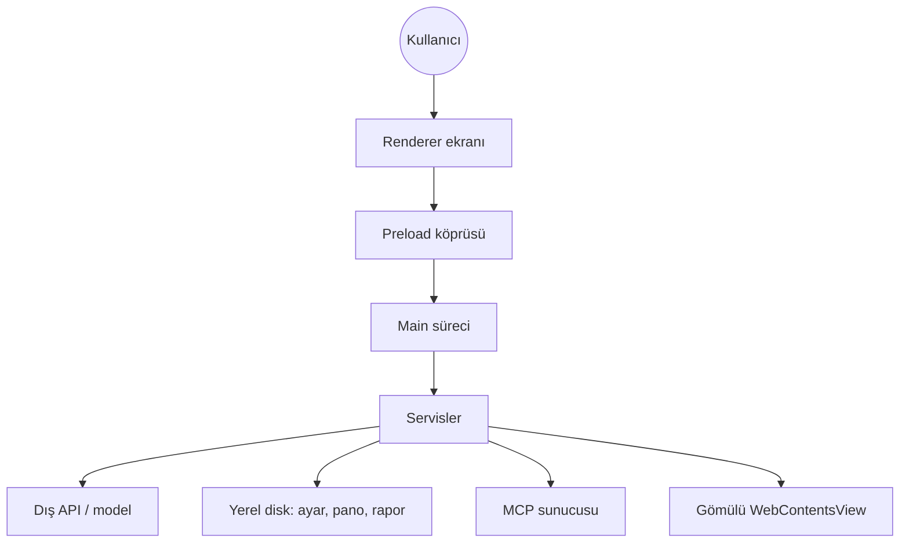

# Mimari ve Sistem Tasarımı

Keyvotion Console, yapay zeka ajan ekiplerini (LDR/YM/ARC/DEV/DSN/QA/OPS) yöneten, entegrasyon ve MCP katmanıyla genişleyen, **yerel öncelikli (local-first)** bir Windows masaüstü konsoludur. Sunucu kurulumu gerekmez: tüm veri kullanıcının diskinde durur.

## Genel Bakış

Uygulama Electron üzerinde çalışır ve üç süreçli bir mimari kullanır:

```
Renderer → Preload (dar köprü) → Main (ayrıcalıklı)
```

Amaç: LLM tabanlı ajanları rollere ayırmak ve onların dış dünyaya (API'ler, dosyalar, MCP sunucuları) erişimini **denetimli** biçimde sağlamak.

### Temel Özellikler

- **Ajan ekibi orkestrasyonu:** Rol bazlı ajan yönetimi, pano, rapor ve mesaj zinciri.
- **Bağlantı katmanı:** 64 entegrasyon + 60 MCP sunucusu = 124 hazır bağlantı şablonu.
- **Zero-trust renderer:** Ağ erişimi tamamen kapalı (`connect-src 'none'`), `webview`/`iframe` yok.
- **Yerel depolama:** Sırlar ve parolalar `safeStorage` (Windows DPAPI) ile şifrelenir; proje verileri (pano, raporlar, katalog JSON'ları) kullanıcının diskinde **düz metin** durur. Bulut yok, telemetri yok.

## Süreç ve Güvenlik Modeli

Güvenlik, saldırı yüzeyini küçültmek üzerine kuruludur.

### 1. Sandbox renderer (arayüz)

- **Ağ yok:** CSP `connect-src 'none'`; renderer hiçbir HTTP isteği açamaz.
- **Webview/iframe yok:** Dış içerik `services/browser.js` üzerinden main prosesde bir **`WebContentsView`** içinde gösterilir; `webview` etiketi kullanılmaz.
- **`innerHTML` yok:** Dinamik metin yalnız `textContent` ile yazılır.
- **Inline `style=""` yok:** Stil yalnız CSS sınıfları ve `--kv-*` değişkenleriyle verilir; ham renk yalnız `styles/` altında geçerlidir.

### 2. Ayrıcalıklı main süreci

Dosya yazma, ağ çağrısı, MCP yürütme ve model erişimi yalnız main sürecinde olur. Renderer, main ile **preload köprüsü** üzerinden konuşur.

### 3. Dar köprü (preload)

Preload, renderer ile main arasındaki tek geçiş noktasıdır. Rastgele fonksiyon açmaz; yalnız sözleşmede tanımlı IPC kanallarını `1:1` açar (doctor bu eşleşmeyi doğrular).

## Kanal Katmanı

`src/shared/ipc-channels.js` tüm iletişimin tek kaynağıdır.

### Kanal istatistikleri (ölçüldü)

- Toplam **111** kanal = **106 invoke + 5 push**
- **45** yazma kanalı; her biri `confirmToken` ile korunur
- **31** domain

### Domain dağılımı (31)

`kv:app`, `kv:audit`, `kv:board`, `kv:browser`, `kv:chat`, `kv:command`, `kv:event`, `kv:files`, `kv:guide`, `kv:integration`, `kv:mcp`, `kv:mcp-catalog`, `kv:memory`, `kv:models`, `kv:oauth`, `kv:permission`, `kv:plan`, `kv:preset`, `kv:project`, `kv:provider`, `kv:remote`, `kv:reports`, `kv:roster`, `kv:secret`, `kv:server`, `kv:settings`, `kv:skill`, `kv:team`, `kv:teams`, `kv:voice`, `kv:votion`.

### Ürün yüzeyi (ölçüldü)

| Öğe | Sayı |
| --- | --- |
| Ekran | 23 |
| Stylesheet | 19 |
| `--kv-*` token | 117 tekil ad (785 tanım; `tokens.css` 107) |
| Kanal | 111 (106 invoke + 5 push) |
| Yazma kanalı | 45 |
| Domain | 31 |
| Entegrasyon | 64 |
| Yetenek (capability) | 195 |
| MCP sunucusu | 60 |
| Bağlantı şablonu (preset) | 124 |
| Otomatik test | 574 |

Bu sayılar `node tools/verify/ldr-domain.js` (domain), `node tools/verify/tap-count.js tests` (test), `src/renderer/index.html` sayımı (ekran, stylesheet) ve `src/main/services/` + `src/renderer/styles/` dizin sayımı (servis, token) ile ölçülür.

## Servis Haritası

`src/main/services/` altında **41 dosya** (37 JS servisi + 3 katalog JSON'u + `remote-page.html`) bulunur. Kritik servisler:

| Servis | Görev |
| --- | --- |
| `integrations.js` | Entegrasyon kataloğu, yetenek yürütme, audit |
| `connection-presets.json` | 124 bağlantı şablonu (64 entegrasyon + 60 MCP) |
| `mcp-registry.js` / `mcp-client.js` | MCP kurulum, araç listesi, çağrı |
| `providers.js` / `models-store.js` | Sağlayıcı anahtarları (`safeStorage`), model kataloğu |
| `votion-tools.js` / `votion-actions.js` | Votion asistanının beyaz listeli araç erişimi |
| `oauth.js` | OAuth2 akışı (loopback callback) |
| `remote.js` | LAN'dan telefondan erişim (jeton, özel ağ, 64 KB, 60/dk) |
| `server-manager.js` | Yerel OpenCode sunucusu (port + `/api/info` ölçümü) |
| `browser.js` | İzole gömülü tarayıcı (`WebContentsView`) |
| `audit.js` | Yazma denetimi: `{op, capabilityId, status}` |
| `settings.js` / `providers.js` / `integrations.js` | Ayar, sır ve sağlayıcı anahtarı saklama (`secrets.bin`, `safeStorage`); `onboarded` bayrağı |

## Veri Akışı



## Bağımlılık Politikası

- **Çalışma zamanı:** yalnız `electron` (45.2.1).
- **Test:** `node --test` (harici test çerçevesi yok).
- **Arayüz:** framework yok; saf JS + CSS. `doctor` bağımlılık listesini denetler.

## Genişletme Rehberi

1. **Yeni entegrasyon:** `integration-catalog.json`'a tanım, `connection-presets.json`'a şablon, `testCapability` davranışı; ilgili testi ekle.
2. **Yeni ekran:** `docs/console-ui-contract.md` §2'ye kimlik, `index.html` link zinciri, `turXX.css` katmanı, kanal bağlantısı.
3. **Yeni kanal:** `ipc-channels.js` (domain + ad), preload eşlemesi, main handler; yazma kanalıysa `confirmToken`.

Paket arşivi `tools/lib/deterministic-zip.js` ile yazılır: sabit zaman damgası (1980-01-01),
sıralı girişler, ek alan yok. Aynı `src/` ağacı her zaman **aynı** SHA-256 üretir; bu yüzden
yayın özeti yeniden üretimle doğrulanabilir.

Her eklemeden sonra dört kapı yeşil olmalıdır: `node tools/verify/tap-count.js tests`, `node tools/doctor.js`, `node tools/k3.js`, `node tools/verify/html-check.js`.
